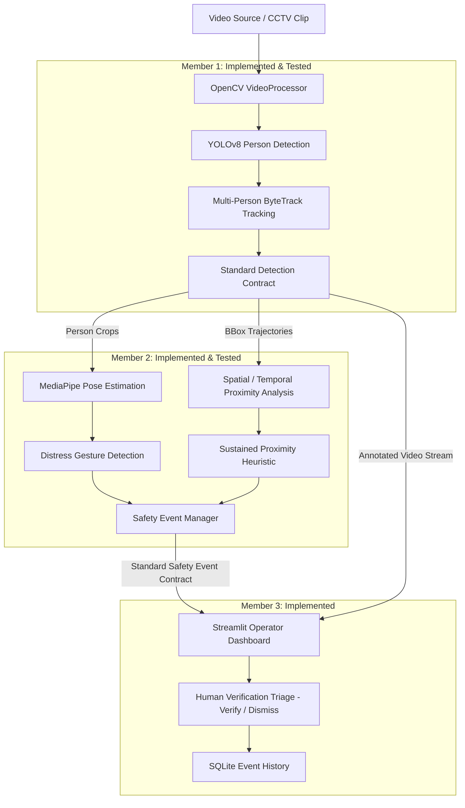

# Women Safety Analytics — System Architecture

This document describes the end-to-end architecture of the **Women Safety Analytics** CCTV prototype, detailing Member 1 (Video & Tracking), Member 2 (Safety Event Analytics), and Member 3 (Dashboard & Database).

---

## 1. End-to-End System Pipeline



---

## 2. Component Status & Ownership

| Component | Responsible | Status | Location | Notes |
| :--- | :--- | :--- | :--- | :--- |
| **Video Reader & Metadata** | Member 1 | **Complete** | `src/detection/video_processor.py` | Handles files & camera, FPS, frame tracking, timestamps. |
| **YOLO Person Detection** | Member 1 | **Complete** | `src/detection/person_detector.py` | Loads YOLO once, detects COCO class 0 ('person') only. |
| **Multi-Person Tracking** | Member 1 | **Complete** | `src/detection/tracking.py` | Assigns persistent tracking IDs, handles missing IDs. |
| **Safe Cropping & Drawing** | Member 1 | **Complete** | `src/utils/helpers.py` | `get_person_crop`, coordinate clamping, visual annotations. |
| **Member 1 CLI Demo** | Member 1 | **Complete** | `main.py` | Standalone CLI for detection & tracking verification. |
| **MediaPipe Pose Estimation**| Member 2 | **Complete** | `src/safety/pose_detector.py` | Reused Pose model, extracts 33 skeleton landmarks from crops. |
| **Distress Gesture Detection**| Member 2 | **Complete** | `src/safety/distress_detector.py` | Both hands raised above shoulders held $\ge 1.0$s + cooldown. |
| **Sustained Proximity Analysis**| Member 2 | **Complete** | `src/safety/proximity_detector.py` | Normalized distance + cosine motion similarity + cooldown. |
| **Safety Event Manager** | Member 2 | **Complete** | `src/safety/event_manager.py` | Factory & validator for standard event dictionaries. |
| **Safety Facade API** | Member 2 | **Complete** | `src/safety/safety_event_detector.py` | Unified public facade & visual overlay helper. |
| **Member 2 Integrated Demo** | Member 2 | **Complete** | `demo_safety.py` | CLI demo integrating Member 1 detection + Member 2 events. |
| **Streamlit Dashboard** | Member 3 | **Complete** | `src/dashboard/app.py` | Uploaded-video processing and annotated video feed. |
| **Alert Verification UI** | Member 3 | **Complete** | `src/dashboard/app.py` | Pending alerts can be marked verified or dismissed. |
| **SQLite Event Storage** | Member 3 | **Complete** | `src/database/database.py` | Persists events and current review status; unique identity prevents rerun duplicates. |

### Member 3 Runtime Flow

The dashboard creates one `VideoProcessor`, `PersonDetector`, and `SafetyEventDetector` when the operator starts a video. It reads one frame per Streamlit fragment tick, passes that frame to `PersonDetector.detect_frame()`, passes the returned `frame_data` to `SafetyEventDetector.process_frame()`, then overlays Member 2's events on Member 1's annotated image. Each event is inserted into SQLite using a deterministic unique identity. The detector objects and per-video temporal state remain in Streamlit session state between fragment updates; they are released at end-of-video or reset.

The dashboard does not implement a detector, tracker, pose estimator, or safety heuristic. It displays the latest frame's person count and the database's event/status counts.

---

## 3. Interfaces & Contracts

### A. Detection Output Contract (Member 1 → Member 2)
For every processed frame, `PersonDetector.detect_frame()` produces:
```python
{
    "frame_id": 125,                    # int: Sequential 1-indexed frame number
    "timestamp": 4.16,                  # float: Elapsed video time in seconds
    "frame": original_frame,            # np.ndarray: Raw BGR frame
    "annotated_frame": annotated_frame, # np.ndarray: BGR frame with bounding boxes and labels
    "people": [
        {
            "track_id": 1,              # int or None: Persistent tracking ID
            "bbox": [120, 80, 240, 360],# list: [x1, y1, x2, y2] clamped pixel coordinates
            "confidence": 0.91          # float: Model confidence (0.0 to 1.0)
        }
    ]
}
```

### B. Standard Safety Event Contract (Member 2 → Member 3)
When a potential safety condition is triggered:
```python
{
    "event_type": "potential_distress_gesture", # str: "potential_distress_gesture" | "sustained_proximity"
    "track_ids": [2],                           # list[int]: Involved tracking IDs
    "timestamp": 12.7,                          # float: Video time when event occurred
    "frame_id": 381,                            # int: Frame sequence number
    "camera_id": "CAM_01",                      # str: CCTV camera identifier
    "confidence": 0.84,                         # float: Heuristic score (0.0 to 1.0)
    "status": "pending",                        # str: Default initial status for Member 3 triage
    "details": {                                # dict: Diagnostic telemetry for operators
        "held_duration_sec": 1.4,
        "consecutive_frames": 14,
        "wrist_elevation": 0.22,
        "disclaimer": "Potential safety event requiring human verification."
    }
}
```

### C. Dashboard and persistence

- Launch from the repository root with `streamlit run src/dashboard/app.py`.
- Upload formats are MP4, AVI, MOV, and MKV; a temporary local file is removed after completion or reset.
- The default camera ID is `CAM_01`; the selected ID is passed to the safety detector at initialization.
- `src/database/database.py` creates `data/events.db` and an `events` table with JSON `track_ids`, video timestamp, frame ID, camera ID, heuristic confidence, review status, source filename, timestamps, and a unique `identity_key`.
- `pending` means not reviewed; `verified` and `dismissed` record the operator's review outcome. These statuses do not make a legal or factual determination about a crime.
- The event score is a heuristic, not a calibrated probability. Tracking IDs are temporary and can change after occlusion.

---

## 4. Privacy and Responsible AI Design

1. **No Biometric Profiling**:
   - The system detects generic persons only (class 0 in COCO).
   - No facial recognition, gender classification, ethnicity detection, or demographic classification is implemented.
2. **Ephemeral Tracking Identifiers**:
   - Tracking IDs (`Person 1`, `Person 2`) are video-session scoped counters and do not map to real-world identities.
3. **Probabilistic Safety Triage & Non-Accusatory Language**:
   - Incidents are explicitly flagged as **"Potential Safety Event"**, **"Potential Distress Gesture"**, or **"Sustained Proximity"**.
   - The system does not classify crimes, harassment, or guilt; human operator verification is mandatory before action is taken.
4. **Monocular Camera Limitation**:
   - Monocular CCTV video does not yield calibrated 3D world distances; proximity is computed in normalized image-space scale.
