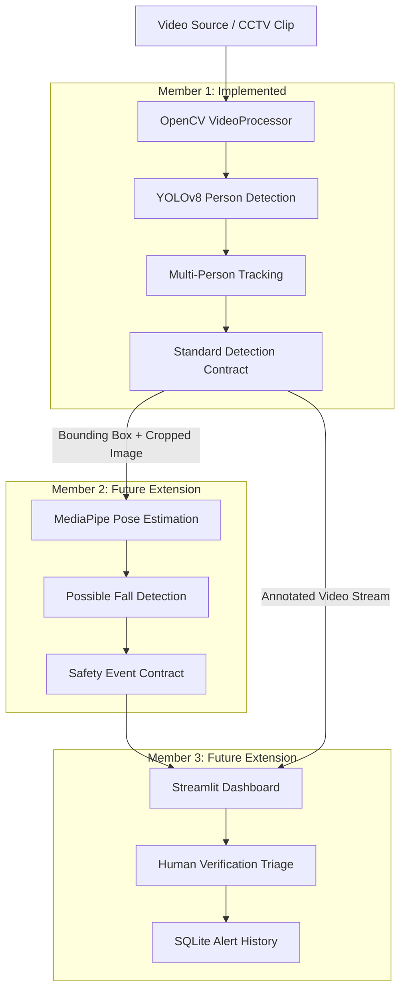

# Women Safety Analytics — System Architecture

This document describes the end-to-end architecture of the **Women Safety Analytics** prototype, detailing current implementations (Member 1) and future integration extension points (Members 2 & 3).

---

## 1. End-to-End Conceptual Pipeline



---

## 2. Component Status & Ownership

| Component | Responsible | Status | Location | Notes |
| :--- | :--- | :--- | :--- | :--- |
| **Video Reader & Metadata** | Member 1 | **Implemented** | `src/detection/video_processor.py` | Handles files & camera, FPS, frame tracking, timestamps. |
| **YOLO Person Detection** | Member 1 | **Implemented** | `src/detection/person_detector.py` | Loads YOLO once, detects COCO class 0 ('person') only. |
| **Multi-Person Tracking** | Member 1 | **Implemented** | `src/detection/tracking.py` | Assigns persistent tracking IDs, handles missing IDs. |
| **Safe Cropping & Drawing** | Member 1 | **Implemented** | `src/utils/helpers.py` | `get_person_crop`, coordinate clamping, visual annotations. |
| **CLI & Video Writer Demo** | Member 1 | **Implemented** | `main.py` | Interactive display, `--save` output video, headless mode. |
| **MediaPipe Pose Estimation**| Member 2 | *Extension Point* | `src/safety/` | Extracts 33 skeleton landmarks from person crops. |
| **Possible-Fall Detection** | Member 2 | *Extension Point* | `src/safety/` | Posture change & rapid downward velocity detection. |
| **Streamlit Dashboard** | Member 3 | *Extension Point* | `src/dashboard/` | Interactive video player, alert feed, status badges. |
| **Alert Verification UI** | Member 3 | *Extension Point* | `src/dashboard/` | "Verify" and "Dismiss" triage workflow buttons. |
| **SQLite Alert Storage** | Member 3 | *Extension Point* | `src/database/` | Persists alerts, timestamps, audit history. |

---

## 3. Interfaces & Contracts

### A. Detection Output Contract (Member 1 → Downstream)
For every processed frame, `PersonDetector.detect_frame()` produces:
```python
{
    "frame_id": 125,                    # int: Sequential 1-indexed frame number
    "timestamp": 4.16,                  # float: Elapsed video time in seconds
    "frame": original_frame,            # np.ndarray: Raw BGR frame
    "annotated_frame": annotated_frame, # np.ndarray: BGR frame with bounding boxes and labels
    "people": [
        {
            "track_id": 1,              # int or None: Persistent tracking ID
            "bbox": [120, 80, 240, 360],# list: [x1, y1, x2, y2] clamped pixel coordinates
            "confidence": 0.91          # float: Model confidence (0.0 to 1.0)
        }
    ]
}
```

### B. Safety Event Contract (Member 2 → Member 3)
When a safety condition is triggered:
```python
{
    "event_type": "possible_fall",      # str: Event category ("possible_fall", "distress_gesture")
    "track_id": 3,                      # int or None: Person identifier
    "timestamp": 12.7,                  # float: Video time when event occurred
    "camera_id": "CAM_01",              # str: CCTV camera identifier
    "confidence": 0.81,                 # float: Event detection confidence
    "status": "pending"                 # str: Initial status ("pending", "verified", "dismissed")
}
```

---

## 4. Privacy and Responsible AI Design

1. **No Biometric Profiling**:
   - The system detects generic persons only (class 0 in COCO).
   - No facial recognition, gender classification, ethnicity detection, or demographic classification is implemented.
2. **Ephemeral Tracking Identifiers**:
   - Tracking IDs (`Person 1`, `Person 2`) are video-session scoped counters and do not map to real-world identities.
3. **Probabilistic Safety Triage**:
   - Incidents are explicitly flagged as **"Potential Safety Event"** or **"Possible Fall"**.
   - No automated claim of confirmed crimes or emergency finality; human operator verification is mandatory before action is taken.
